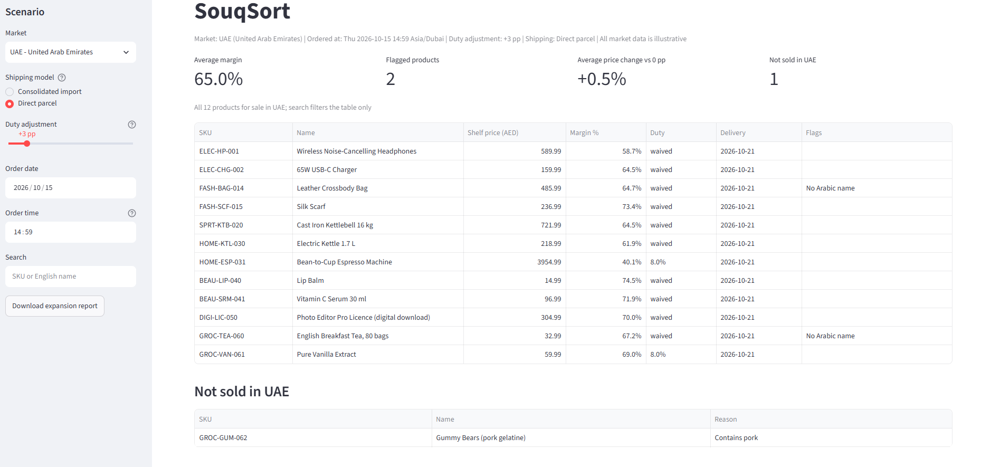

# SouqSort

[](https://github.com/yazanlouid/souqsort/actions/workflows/ci.yml)

SouqSort is a localisation and pricing engine for a UK-based retailer launching its catalogue in the
GCC. It turns a global catalogue priced in USD/GBP into market-ready shelf prices (FX, freight,
duty, VAT, rounding and charm endings), margins and delivery dates for three markets: Saudi Arabia
(KSA), the UAE and Kuwait. It is built for an expansion director who picks a market and a shipping
model, moves a tariff slider and sees what happens to prices, margins and delivery promises, in a
Streamlit dashboard or from the command line. Products a market does not allow are reported as not
sold, with the reason.

> [!IMPORTANT]
> **All market data is illustrative.** FX rates, VAT and duty rates, de minimis thresholds, freight
> costs, holidays, compliance rules and the product catalogue are sample values written for this
> demo. Do not use them to quote real prices or delivery dates.



## Sample run

The same scenario as the screenshot: the UAE, shipped as direct parcels, duty up 3 percentage
points, ordered on Thursday 15 October 2026 at 14:59 Dubai time.

```console
$ uv run python -m souqsort price --market UAE --shipping parcel --duty-adjust 3 --ordered-at 2026-10-15T14:59+04:00
Market: UAE (United Arab Emirates)   Ordered at: 2026-10-15 14:59 Asia/Dubai   Duty adjustment: +3 pp   Shipping: parcel

SKU           Name                                         Shelf price (AED)  Margin %    Duty  Delivery    Flags
------------  -------------------------------------------  -----------------  --------  ------  ----------  -------------------
ELEC-HP-001   Wireless Noise-Cancelling Headphones                    589.99     58.7%  waived  2026-10-21  -
ELEC-CHG-002  65W USB-C Charger                                       159.99     64.5%  waived  2026-10-21  -
FASH-BAG-014  Leather Crossbody Bag                                   485.99     64.7%  waived  2026-10-21  missing_arabic_name
FASH-SCF-015  Silk Scarf                                              236.99     73.4%  waived  2026-10-21  -
SPRT-KTB-020  Cast Iron Kettlebell 16 kg                              721.99     64.5%  waived  2026-10-21  -
HOME-KTL-030  Electric Kettle 1.7 L                                   218.99     61.9%  waived  2026-10-21  -
HOME-ESP-031  Bean-to-Cup Espresso Machine                           3954.99     40.1%    8.0%  2026-10-21  -
BEAU-LIP-040  Lip Balm                                                 14.99     74.5%  waived  2026-10-21  -
BEAU-SRM-041  Vitamin C Serum 30 ml                                    96.99     71.9%  waived  2026-10-21  -
DIGI-LIC-050  Photo Editor Pro Licence (digital download)             304.99     70.0%  waived  2026-10-21  -
GROC-TEA-060  English Breakfast Tea, 80 bags                           32.99     67.2%  waived  2026-10-21  missing_arabic_name
GROC-VAN-061  Pure Vanilla Extract                                     59.99     69.0%    8.0%  2026-10-21  -

Not sold in UAE (1):
SKU           Name                         Reasons
------------  ---------------------------  -------------
GROC-GUM-062  Gummy Bears (pork gelatine)  contains_pork
```

Each direct parcel is cleared on its own, and the UAE charges no customs duty on one whose CIF
(goods + freight) is AED 1,000 or less. So most products pay no duty, and the +3 pp slider leaves
their prices exactly where they were at 0 pp. Only two products pay duty, at 5% + 3 pp = 8%:

- **The espresso machine** is over the threshold: its CIF is about AED 3,487.19.
- **The vanilla extract** is well under it (CIF AED 52.11), but the UAE excludes alcohol from de
  minimis, including food preparations containing alcohol, and vanilla extract contains alcohol.

These two are the only prices the slider moves: 3844.99 → 3954.99 and 57.99 → 59.99, which is why
the dashboard's average price change is only +0.5%.

**The gummy bears are not sold** because they contain pork gelatine, and the UAE bans
`contains_pork`. They are screened out before pricing, so they are never priced, and they are listed
with the reason instead of silently disappearing.

The order lands one minute before the UAE's 15:00 cut-off, so it ships the same day and arrives four
business days later, skipping the Saturday–Sunday weekend. `--ordered-at` is fixed here so the
output is reproducible; without it the CLI uses the current time.

The shipping model is a real trade-off. Parcel freight costs twice as much per kg, so light,
valuable items get cheaper as parcels and heavy or cheap ones get dearer. In KSA, the headphones go
from 686.95 to 660.95 SAR, but the 16 kg kettlebell goes from 593.95 to 875.95. Kuwait has no de
minimis, so a parcel there is never cheaper.

## The expansion report

The dashboard answers one market at a time. The expansion report puts them side by side: for one
order, it prices the catalogue in every market in the config, under both shipping models, at today's
duty rates and with tariff rises of 5, 10 and 20 percentage points as stress tests. It shows how one
price is built in each market, flags prices whose ending adds more than 10%, and lists what each
market cannot sell, with the reasons. Its only inputs are the data files and the order time, so the
same order always gives the same file, byte for byte.

```sh
uv run python -m souqsort report --ordered-at 2026-10-15T09:00Z
```

This writes `outputs/GCC_EXPANSION_REPORT.md`. `--ordered-at` needs a UTC offset because the report
covers every market, and defaults to now. In the dashboard, **Download expansion report** in the
sidebar gives the same report for the order date and time picked there; the duty slider, shipping
model and search don't change it.

[`docs/GCC_EXPANSION_REPORT.md`](docs/GCC_EXPANSION_REPORT.md) is the report for the sample data,
for an order on Thursday 15 October 2026 at 09:00 UTC. Three of its findings:

- **Parcels in KSA.** Direct parcels pay no duty on 10 of the 11 products KSA sells, but dearer
  parcel freight means they are cheaper than consolidated imports for only 6 of them.
- **A 10 pp tariff rise.** In KSA it lifts average prices by 9.0% for consolidated imports but only
  0.9% for direct parcels, because de minimis waives the duty on most parcels whatever the rate.
- **Kuwait's lip balm.** The 0.950 price ending takes it from 1.157 to 1.950 KWD, adding 68.5%.

## What makes it tricky

- **Money.** `Decimal` throughout, rounded once with `ROUND_HALF_UP`: 0.0005 at 3 decimals gives
  0.001, where banker's rounding would give 0.000. Charm endings never lower a price
  (686.96 becomes 687.95, not 686.95). KWD uses 3 decimals, not 2.
- **Tax order.** Duty is charged on CIF (goods + freight); VAT is charged on CIF + duty, and still on
  CIF when de minimis waives the duty.
- **FX order.** Multiply before dividing. Dividing first turned an exact 0.075 into 0.07499…97,
  which rounds to 0.07 instead of 0.08.
- **De minimis.** The threshold is compared with the unrounded CIF in the market currency, including
  the dearer parcel freight. KSA waives duty *below* SAR 1,000 and the UAE *at or below* AED 1,000,
  so a CIF of exactly 1,000.00 pays duty in one and not the other. The duty slider never changes
  whether a product is waived, and a waived product pays nothing at any adjustment.
- **Compliance.** Each market lists the product attributes it does not allow. A banned product is
  never priced for that market and never silently dropped: it is reported as not sold, with its
  reasons. KSA and Kuwait sell 11 of the 13 products, the UAE 12.
- **Delivery.** Orders are converted to market time first: Thursday 22:30 UTC is already Friday,
  the weekend, in Riyadh, but a working day in Dubai. The cut-off is compared as a moment in time,
  so a clock change can't make a later order arrive earlier.
- **Errors.** A product that can't be priced fails with a message naming its SKU; unexpected bugs
  keep their traceback.
- **Tests.** 1,000+ tests, including every worked example and price list in the spec, Hypothesis
  property tests, headless dashboard tests (Streamlit's `AppTest`) and architecture tests that keep
  floats, market codes, the clock and pandas out of the engine.

## Install and run

Requires [uv](https://docs.astral.sh/uv/). It installs Python 3.12 if you don't have it.

```sh
git clone https://github.com/yazanlouid/souqsort.git
cd souqsort
uv sync
```

| To | Run |
|---|---|
| Price a market from the CLI | `uv run python -m souqsort price --market KSA` |
| Price UAE direct parcels | `uv run python -m souqsort price --market UAE --shipping parcel` |
| Write the expansion report | `uv run python -m souqsort report` |
| Open the dashboard | `uv run streamlit run app/streamlit_app.py` |
| Run the tests | `uv run pytest` |
| Format, lint and type-check | `uv run ruff format --check .`, `uv run ruff check .` and `uv run mypy src` |

CLI options for `price`:

| Option | Meaning |
|---|---|
| `--market CODE` | Market code from the config: `KSA`, `UAE` or `KWT` (required). |
| `--shipping MODEL` | `consolidated` (one commercial import, de minimis never applies) or `parcel` (each order cleared on its own, duty-free under the market's de minimis threshold, dearer freight). Default `consolidated`. |
| `--duty-adjust POINTS` | Whole percentage points added to every duty rate, 0 to 20. Default 0. |
| `--ordered-at ISO` | Order date and time, e.g. `2026-10-15T20:59Z`. Without an offset it is read as local time in the market. Default: now. |
| `--csv PATH` | Also write the rows for the products for sale to a CSV file. |

## Design rules

- **Decimal money.** Money, rates and weights are `decimal.Decimal`, never `float`. In JSON they are
  strings, and a number where a string belongs is rejected when the file is loaded.
- **Round once.** Every step keeps full precision. The only rounding is at the shelf price, with
  `ROUND_HALF_UP` to the currency's minor units; the charm ending then only ever moves a price up.
- **Markets as config.** A market is an entry in `data/raw/gcc_config.json`: currency, VAT, duty
  rates, de minimis rule, banned attributes, weekend, holidays, cut-off, freight and parcel freight.
  The UAE and Kuwait were added without changing any code, and no code branches on a market code.
- **Not sold, never dropped.** A product a market does not allow is never priced for it, and is
  always reported with the reason.
- **No clock in the engine.** The engine never reads the current time; it is always passed a
  timezone-aware `ordered_at`. Only the entry points read the clock: the CLI, through an injectable
  `now` callable, and the dashboard, for its picker defaults. Every result is reproducible and
  testable.

The full rules, with worked examples, are in [SPEC.md](SPEC.md).

## How it was built

- **Spec first.** [SPEC.md](SPEC.md) set the rules, worked examples and acceptance tests before any
  code.
- **Test-first milestones.** Each milestone was planned and built test-first with
  [Claude Code](https://claude.com/claude-code), on its own branch, and reached `main` through a
  pull request.
- **CI.** GitHub Actions runs the format check, lint, type check and tests on Ubuntu and Windows
  for every pull request and every push to `main`, and fails on a stale `uv.lock`.
- **Project tools for Claude Code**, in `.claude/`:
  - `/verify` runs the same four checks as CI and ends with `verify: PASS` or `verify: FAIL`.
  - `/add-market CODE "Name"` adds a market as config data plus its tests, without touching code.
    The UAE and Kuwait were added with it.
  - A format hook runs `ruff format` on every Python file Claude edits.
  - The `money-reviewer` subagent checks a branch against the money rules (Decimal only, one
    rounding, duty and VAT bases, de minimis, compliance) before code review.
- **Independent review.** The work was reviewed by an independent AI code review, and the de minimis
  milestone by the money-reviewer as well. I triaged every finding; decisions are recorded in the
  spec, and deferred items are tracked as
  [GitHub issues](https://github.com/yazanlouid/souqsort/issues).

## Status

**v0.2.0: three markets, compliance and de minimis.** KSA, the UAE and Kuwait; banned product
attributes reported as not sold; a consolidated-import or direct-parcel shipping model, with de
minimis thresholds; the duty rate and any de minimis waiver in the CLI, the CSV and the dashboard.

**v0.1.0:** KSA end to end: catalogue and config validation, landed-cost pricing with margins,
delivery estimates, the CLI and the dashboard.

Roadmap:

- **v0.3:** a `GCC_EXPANSION_REPORT.md` generated from a template, with a download button in the
  dashboard, building on the consolidated-versus-parcel comparison.
- **Later:** pricing refinements (per-parcel fees, orders of several items, a finer price ladder for
  KWD), calculation traces, and a data pipeline. See [SPEC.md](SPEC.md) §2.
